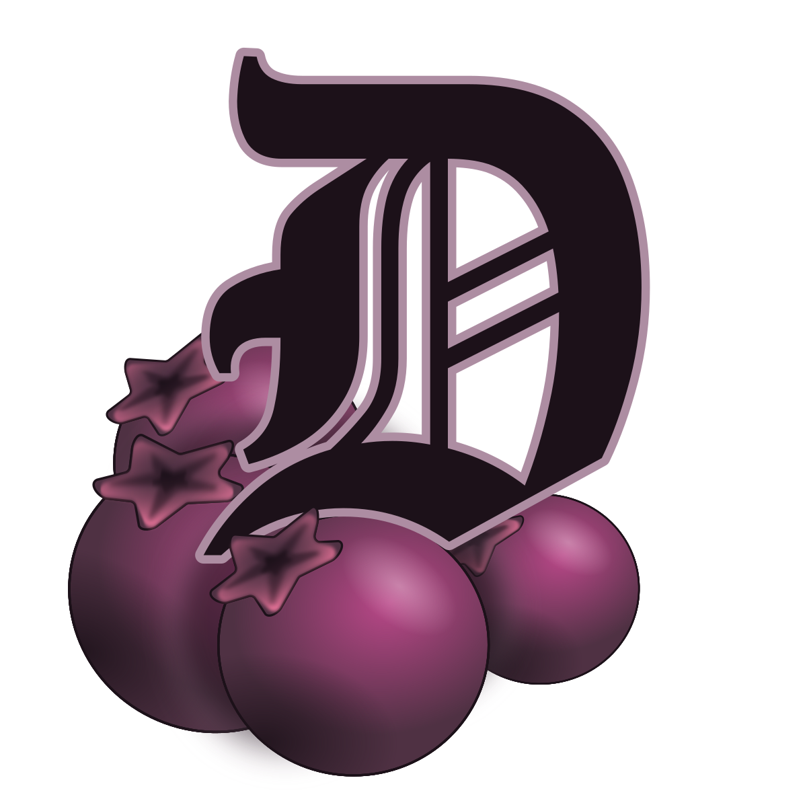
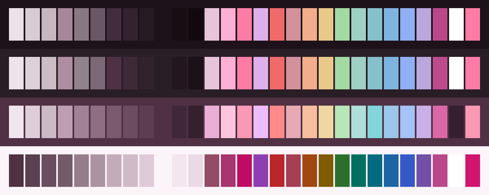
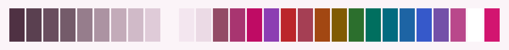
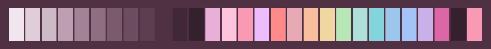

<h3 align="center">
	 
	
	Darkberry for <a href="https://claude.com/claude-code">Claude Code</a>
	
</h3>

	
	
	

	
	
	
	
	

	

## Previews

🕯️ Wisp

🌾 Fen

🪦 Mire

🌑 Blackwater

## Usage

Not on a theme store yet. The files are in [ports/claude-code](https://github.com/shythulu/DarkBerry/tree/main/ports/claude-code); install them by hand:

1. Copy a flavour's `.json` file from this folder into `~/.claude/themes/`. Keep the file
   name: it is the theme's id, saved as `custom:darkberry-<flavour>` in your settings.
2. Run `/theme` in Claude Code and pick the flavour. The folder is watched, so a running
   session picks up the file without a restart. If `~/.claude/themes/` did not exist when
   Claude Code started, restart it once.

Needs Claude Code 2.1.118 or newer, where custom themes arrived. The ultracode tag colour
(`effortUltra`) applies from 2.1.239. Use a truecolour terminal; on a 256-colour one Claude
Code rounds the colours.

A Claude Code theme colours the accent, diffs, status, borders and mode indicators. The
background and the body text of replies belong to your terminal, so pair this with
Darkberry's terminal port of the same flavour, such as [Ghostty](../ghostty),
[kitty](../kitty) or [Alacritty](../alacritty). Wisp is a light theme and needs a light
terminal under it.

## Created by

- [shythulu](https://github.com/shythulu)

&nbsp;

	

	Copyright &copy; 2026-present <a href="https://github.com/shythulu/DarkBerry" target="_blank">shythulu</a>

	

