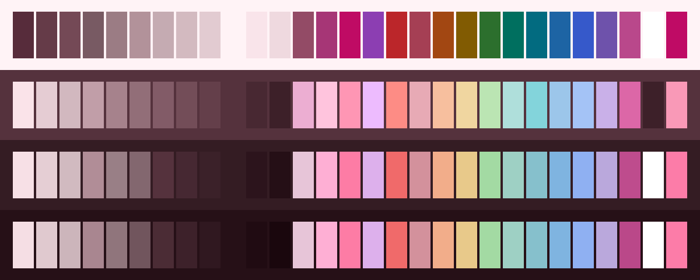

<h3 align="center">
	 
	
	Lingonberry for <a href="https://www.linearity.io">Linearity Curve</a>
	
</h3>

	
	
	

	
	
	
	
	

	

## Previews

🕯️ Wisp

🌾 Fen

🪦 Mire

🌑 Blackwater

## Usage

Not on a theme store yet. The files are in [ports/linearity/lingonberry](https://github.com/shythulu/DarkBerry/tree/main/ports/linearity/lingonberry); install them by hand:

The palette itself, as Adobe Swatch Exchange files: one `.ase` per flavour with the
flavour's 29 colours, each named (Blossom, Petal, Berry and so on, down to Crust), in the
[GIMP Palette](../gpl)'s order.

1. Get the files onto the iPad or Mac with AirDrop, iCloud Drive or Files.
2. In Linearity Curve, open the Color Widget, then Palettes, tap +, then Import, and pick a
   flavour, such as `Darkberry Mire.ase`.

Palettes sync over iCloud between Curve on iPad, Mac and iPhone. Curve has no palette
export, so keep the files: importing them again is the only way back to a deleted palette.

## Created by

- [shythulu](https://github.com/shythulu)

&nbsp;

	

	Copyright &copy; 2026-present <a href="https://github.com/shythulu/DarkBerry" target="_blank">shythulu</a>

	

