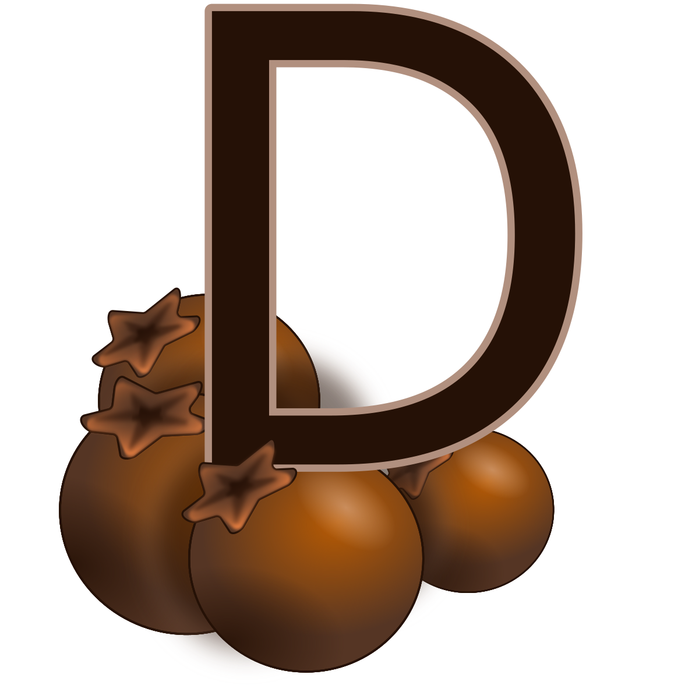
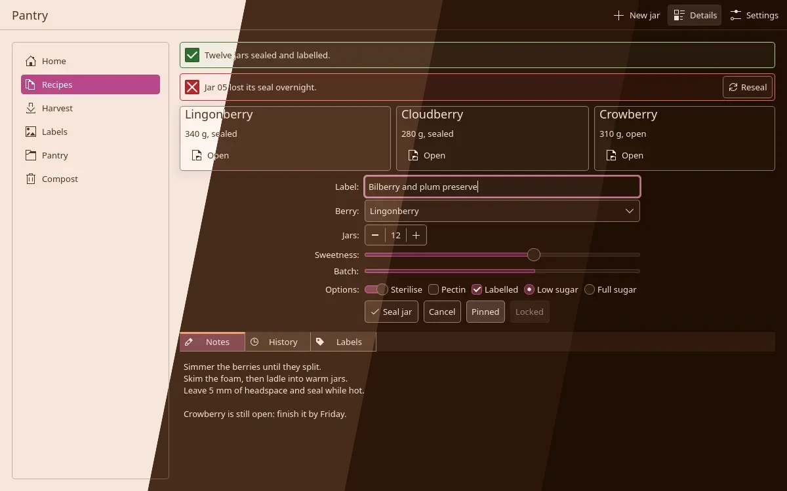
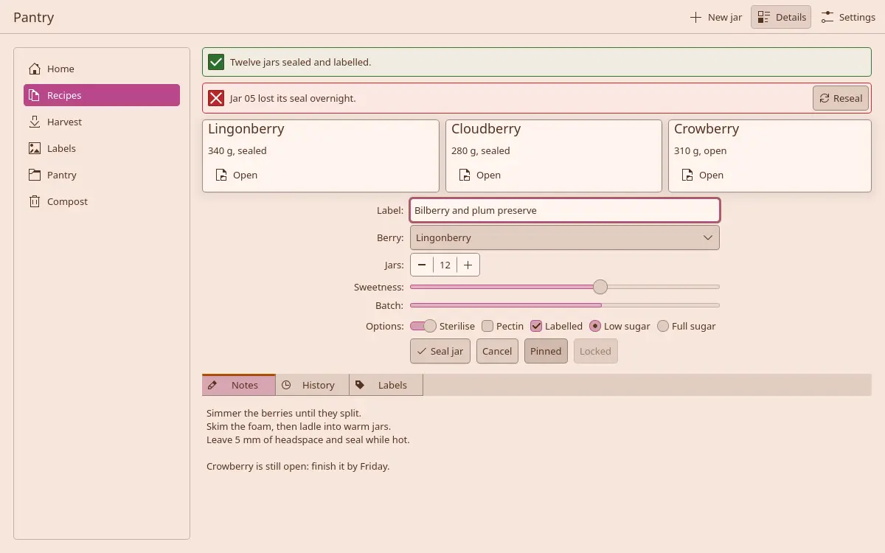
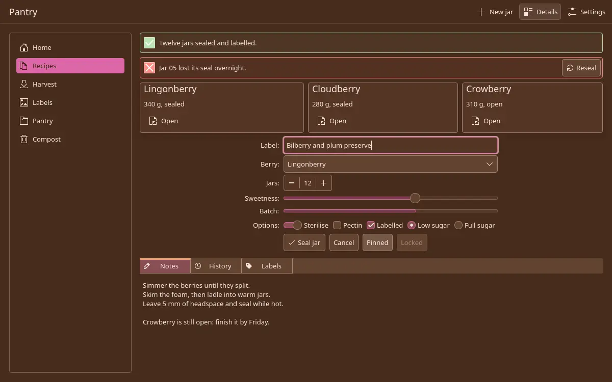
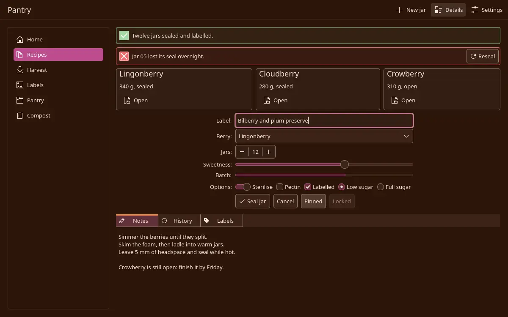
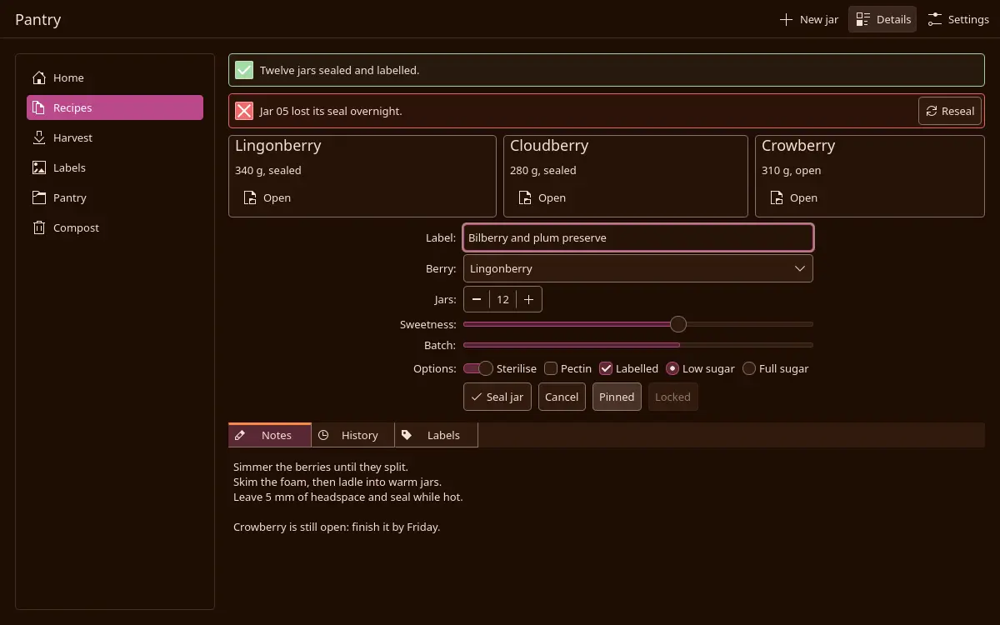

<h3 align="center">
	 
	
	Cloudberry for <a href="https://invent.kde.org/plasma/union">Union</a>
	
</h3>

	
	
	

	
	
	
	
	

	

## Previews

🕯️ Wisp

🌾 Fen

🪦 Mire

🌑 Blackwater

## Usage

Not on a theme store yet. The files are in [ports/union/cloudberry](https://github.com/shythulu/DarkBerry/tree/main/ports/union/cloudberry); install them by hand:

1. Install the matching colour scheme from the [KDE Plasma port](../kde) and pick it in
   System Settings > Colors & Themes > Colors.
2. Copy a flavour's folder (`darkberry-mire`, for example) from this folder into
   `~/.local/share/union/styles/`. `union-styletool install darkberry-mire` does the same.
3. Pick the flavour in System Settings > Colors & Themes > Application Style, click Apply,
   and restart your apps.

Needs Plasma 6.8 or newer with the `union` package installed. Union is a beta in 6.8.

The style is Breeze's own Union style in Darkberry's colours, so it reaches Qt Widgets apps
(Dolphin, Kate, Konsole) and Qt Quick apps alike. Text selection and links still come from
the colour scheme, which is why step 1 comes first. To try a flavour in one app without
changing the desktop, run the app with `UNION_STYLE_NAME=darkberry-mire`.

## Created by

- [shythulu](https://github.com/shythulu)

&nbsp;

	

	Copyright &copy; 2026-present <a href="https://github.com/shythulu/DarkBerry" target="_blank">shythulu</a>

	

